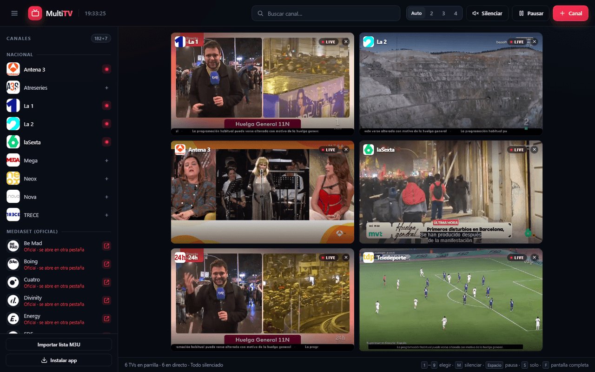

# MultiTV

[](https://github.com/joan-tomas-1995/multitv/actions/workflows/ci.yml)
[](LICENSE)

Parrilla de televisiones españolas en directo dentro de una sola pestaña: todas las TVs a la vez, en mosaico, y control instantáneo de cuál se escucha, cuál se silencia, cuál se pausa o cuál se ve a pantalla completa. Incluye **versión web/PWA** y **app nativa** para iOS y Android.



## Requisitos

- **Node.js 22 o superior** (el proyecto usa `fetch` nativo y módulos ES).
- npm 10 o superior.
- Para la app nativa: **Expo Go** en el móvil (o un *development build*).
- Docker es opcional, solo para desplegar la web.

## Arranque rápido

```bash
npm install
npm start
```

Abre <http://127.0.0.1:5173>. La primera vez arranca con seis canales (La 1, La 2, Antena 3, laSexta, 24h y Teledeporte). El resto está en la lista lateral.

Para verla desde el móvil o la tablet de casa:

```bash
HOST=0.0.0.0 npm start
```

y entra desde el otro dispositivo a `http://IP-DE-TU-PC:5173`.

### Instalar como app (PWA)

MultiTV es una **PWA instalable**: el mismo código funciona como web, como app en Android y como app en iPhone/iPad, sin pasar por las tiendas.

- **Android/Chrome**: menú `⋮` → «Instalar aplicación» (o el botón **Instalar app** de la barra lateral).
- **iPhone/iPad/Safari**: botón Compartir → «Añadir a pantalla de inicio».
- **Escritorio (Chrome/Edge)**: icono de instalar de la barra de direcciones.

La app guarda en caché la interfaz y el último catálogo, así que abre incluso sin conexión (las emisiones, lógicamente, necesitan internet). El service worker y la instalación requieren **HTTPS** o `localhost`; si abres la web por `http://IP-DE-LA-RED` desde el móvil, el navegador no permitirá instalarla.

En iPhone/iPad, si algunas TVs no arrancan a la vez, prueba con 2–4 canales: iOS limita la decodificación simultánea de vídeo.

## App nativa para iOS y Android

Además de la PWA, el proyecto incluye una app nativa independiente con **Expo/React Native** en [`native/`](native/README.md). No necesita el servidor ni el proxy: reproduce el HLS directamente en el dispositivo y resuelve las señales dinámicas de Atresplayer/Brightcove desde la propia app.

```bash
npm run native:sync
cd native
npm install
npx expo start
```

Abre el QR con Expo Go para probarla en el móvil. Para generar un APK o publicar en App Store/Google Play se usa EAS; los pasos completos están en [`native/README.md`](native/README.md).

## Qué hace

- **Mosaico de TVs en directo** con distribución automática o de 2, 3 o 4 columnas. Todos los canales se ajustan a la pantalla sin solaparse (hasta 12 a la vez).
- **Cierre rápido**: cada TV tiene una X junto al indicador LIVE para quitarla de la parrilla.
- **Audio exclusivo con un clic**: al pulsar una TV se escucha solo esa y se silencian las demás. Volver a pulsarla la silencia. También hay un botón de silencio por TV.
- **Pausa, reanudación, solo, pantalla completa y volumen** por canal, más botones de “Silenciar todo” y “Pausar todo”.
- **Arrastra las TVs** para ordenarlas como quieras. El orden, las columnas y el volumen se guardan en el navegador.
- **Lista de canales por comunidades** con buscador (sin distinguir mayúsculas ni tildes).
- **Añadir canales propios** por URL HLS (`+ Canal`) o **importar una lista M3U** completa.
- **Accesos directos oficiales** a Mediaset Infinity para Telecinco, Cuatro, Divinity, FDF, Energy, Boing y Be Mad (se abren en otra pestaña; la señal no se incrusta).
- **Reconexión automática**: si una señal falla, prueba la siguiente URL del mismo canal y reintenta con espera creciente.

### Atajos de teclado

| Tecla | Acción |
| --- | --- |
| `1`–`9` | Elegir y escuchar esa TV |
| `M` | Silenciar / activar el audio de la TV seleccionada |
| `Espacio` | Pausar / reanudar |
| `S` | Ver solo esa TV |
| `F` | Pantalla completa |
| `Esc` | Salir del modo solo |
| `Supr` | Quitar la TV de la parrilla |

## Canales incluidos

El catálogo se genera y **verifica** contra la lista pública de [TDTChannels](https://www.tdtchannels.com/), que recoge emisiones oficiales en abierto, y añade las cadenas que publican HLS accesible desde sus propios reproductores. Incluye más de 180 canales en directo y varios accesos oficiales, entre otros:

- **Nacionales**: La 1, La 2, 24h, Teledeporte, Clan, 3CatInfo, TRECE, Real Madrid TV, Euronews…
- **Atresmedia**: Antena 3, laSexta, Neox, Nova, Mega y Atreseries (señal HLS gratuita de Atresplayer).
- **Autonómicas**: TV3/33/Esport3/SX3, Canal Sur, ETB 1 y 2, TVG y TVG 2, CMM, Canal Extremadura, Telemadrid, À Punt, ETB Deportes…
- **Locales**: más de 130 canales de Andalucía, Baleares, Canarias, Cantabria, Castilla-La Mancha, Castilla y León, Cataluña, Madrid, Comunitat Valenciana, Extremadura, Galicia, La Rioja, Navarra, País Vasco y Murcia.
- **Internacionales**: CNN International, Bloomberg Europe, DW, TV5Monde, Al Jazeera, TeleSUR, ADN40, Medi1 y ATV Andorra.

Cada canal puede tener varias señales; la app usa la primera que responde y cambia a la siguiente si falla.

### Fuentes y criterio

El catálogo solo incluye emisiones públicas, en abierto y sin DRM:

- [TDTChannels](https://www.tdtchannels.com/listas/) es la lista de referencia: de ahí salen los canales y sus URLs.
- [iptv-org](https://github.com/iptv-org/iptv) se usa para localizar logos.
- [Free-TV/IPTV](https://github.com/Free-TV/IPTV) se revisó como contraste; sus enlaces se comprobaron y solo se conservaron los que respondían.
- [Mediaset Infinity](https://www.mediasetinfinity.es/) se enlaza como acceso oficial para Telecinco, Cuatro, Divinity, FDF, Energy, Boing y Be Mad; no se extrae ni se reemite su señal.

También se han revisado listas y artículos de terceros (adslzone, Xataka Móvil, Genbeta, IPTV Pilot y varios repositorios de listas). Muchos contienen redifusiones de señales ajenas, enlaces caducados o dependen de un proveedor; por eso no se incorporan al catálogo. Si tienes una lista propia, usa **Importar lista M3U**: se guarda solo en tu navegador y se reproduce a través del proxy local.

### Canales con resolución dinámica

Las cadenas de Atresmedia y las que usan Brightcove (Telemadrid, À Punt) entregan una URL HLS con token temporal. El servidor pide la URL a la API pública del reproductor oficial en el momento de abrir el canal y la renueva si caduca (`/api/resolve`). Es la misma emisión gratuita con publicidad que ofrecen sus webs, sin DRM ni protección que se esté evitando.

Si alguna deja de funcionar, lo más probable es que hayan cambiado su API o sus identificadores; actualízalos en [`scripts/build-catalog.mjs`](scripts/build-catalog.mjs) y vuelve a ejecutar `npm run catalog`.

### Actualizar el catálogo

Las emisiones cambian de URL con el tiempo. Para volver a comprobar todas las señales y regenerar la lista y los logos:

```bash
npm run catalog
```

El script descarga las listas, prueba cada señal HLS, descarta las que no responden y escribe `data/channels.json` y `public/logos/`. Tarda un par de minutos. Puedes editar la selección de canales en [`scripts/build-catalog.mjs`](scripts/build-catalog.mjs): `SELECTION` contiene los canales con `tvg-id`, `NAME_SELECTION` los que TDTChannels publica sin identificador y `EXTERNAL_CHANNELS` los accesos oficiales que no son HLS.

## Canales que no están (y por qué)

- **Mediaset** (Telecinco, Cuatro, Divinity, FDF, Energy, Boing, Be Mad): su reproductor usa DASH con DRM Widevine/PlayReady, una API privada con autorización y una CSP que impide incrustarlo. No se incluye ni se intenta saltar esa protección; en su lugar hay **accesos directos oficiales** en la lista de canales que abren Mediaset Infinity en otra pestaña.
- **Aragón TV**: su nuevo reproductor (Aragón Play) exige iniciar sesión para ver el directo.
- **IB3**: emite en directo mediante un iframe de YouTube, que no encaja con el mosaico HLS ni permite el control de audio por canal.
- **7RM, DMAX y otras cadenas menores**: no tienen una señal HLS pública y estable sin DRM o sin registro.
- Algunas señales están **geobloqueadas** fuera de España y pueden no verse desde otros países.

Este proyecto no rompe protecciones ni usa credenciales de terceros. Si tienes una fuente legal para esos canales (por ejemplo, una lista M3U de tu proveedor), añádela con `+ Canal` o `Importar lista M3U`: se guarda solo en tu navegador y se reproduce a través del proxy local.

### Ver Telecinco, Cuatro y el resto de Mediaset en el mosaico

La forma legal y estable de tenerlas dentro de MultiTV es capturar la señal de la TDT en tu propia casa y servirla como HLS en la red local. No se redistribuye nada fuera de casa.

1. **Sintonizador**: un lápiz USB DVB-T2 compatible con Linux/Windows o un HDHomeRun en red. Conecta la antena.
2. **Servidor**: [Tvheadend](https://tvheadend.org/) (Docker, Raspberry Pi o PC) o Jellyfin con Live TV. Escanea los canales de tu repetidor.
3. **HLS en la LAN**: activa un perfil HLS. En Tvheadend puedes usar el perfil `webtv-h264-aac-mpegts`; en Jellyfin, la URL HLS que genera para el directo. Ejemplo orientativo de Tvheadend: `http://IP-DEL-SERVIDOR:9981/stream/channel/<id>?profile=webtv-h264-aac-mpegts`.
4. **Añádelo a MultiTV**: botón `+ Canal` (nombre + URL HLS) o `Importar lista M3U` con la lista que genere Tvheadend/Jellyfin.
5. Si el servidor está en otro equipo, comprueba que el puerto es accesible desde el dispositivo donde abres MultiTV. No lo expongas a Internet.

Con esto tendrás Telecinco, Cuatro, Divinity, FDF, Energy, Boing, Be Mad y el resto de la TDT en la parrilla, con la calidad de tu antena y sin DRM.

Los manifiestos FAST directos de Divinity, Energy y Be Mad responden 403 y el reproductor oficial no expone un HLS libre, así que tampoco se pueden añadir como canales HLS. Si Mediaset publica alguna vez una señal abierta, se puede incorporar como un canal más.

## Configuración

| Variable | Por defecto | Descripción |
| --- | --- | --- |
| `PORT` | `5173` | Puerto HTTP |
| `HOST` | `127.0.0.1` | Interfaz de escucha. Usa `0.0.0.0` para acceder desde la red local |

Ejemplo: `PORT=8080 npm start`.

## Desplegar la web

### Docker

```bash
docker build -t multitv .
docker run --rm -p 5173:5173 multitv
```

La imagen sirve la web y el proxy en el puerto 5173 con `HOST=0.0.0.0`.

### HTTPS

Para que la PWA se pueda instalar desde el móvil y funcionar como app, sírvela por **HTTPS** (Caddy, Nginx, Traefik, Cloudflare Tunnel, Tailscale…). `localhost` es la excepción: los navegadores lo tratan como seguro.

Ten en cuenta que:

- Las señales de Atresmedia/Brightcove están pensadas para **España**; si alojas el servidor fuera, algunas pueden devolver 403.
- El proxy consume **el ancho de banda del servidor** por cada espectador. No está pensado para una web pública con muchos usuarios.
- No hay autenticación: si lo expones a internet, protégelo con la autenticación de tu proxy inverso.

## Publicar en las tiendas

La PWA ya se instala en Android e iOS sin pasar por las tiendas. Si quieres una app descargable:

- **App nativa incluida**: compila el proyecto de [`native/`](native/README.md) con [EAS](https://docs.expo.dev/eas/) y súbelo a App Store y Google Play. Los pasos están en [`native/README.md`](native/README.md).
- **PWA empaquetada**: publica la web por HTTPS y usa [PWABuilder](https://www.pwabuilder.com/) para generar un APK/AAB y un proyecto iOS listo para Xcode.

## Estructura del proyecto

```text
.
├── server.mjs                 Servidor HTTP, proxy HLS y resolvers dinámicos
├── data/channels.json         Catálogo generado (canales, grupos, logos y señales)
├── public/                    Web/PWA
│   ├── index.html             Interfaz
│   ├── app.js                 Reproductores, parrilla y persistencia
│   ├── styles.css             Estilos
│   ├── sw.js, manifest...     Service worker y manifiesto PWA
│   ├── icons/                 Iconos de la PWA
│   └── logos/                 Logos de los canales
├── scripts/
│   ├── build-catalog.mjs      Descarga, verifica y genera el catálogo
│   ├── validate-catalog.mjs   Valida el catálogo y sus logos
│   ├── build-icons.mjs        Genera los iconos de la PWA
│   └── sync-native.mjs        Sincroniza catálogo y logos con la app nativa
├── native/                    App Expo/React Native (iOS y Android)
│   ├── App.tsx                Parrilla y estado global
│   ├── src/                   Componentes, resolvers y almacenamiento
│   └── assets/                Catálogo y logos empaquetados
└── .github/workflows/ci.yml   Integración continua
```

## Scripts

| Comando | Qué hace |
| --- | --- |
| `npm start` | Arranca la web y el proxy en el puerto 5173 |
| `npm run catalog` | Regenera `data/channels.json` y los logos comprobando todas las señales |
| `npm run icons` | Regenera los iconos de la PWA a partir del SVG |
| `npm run native:sync` | Copia el catálogo a `native/` y convierte los logos a PNG |
| `npm run validate` | Valida el catálogo (IDs, grupos, logos y señales) |
| `npm run check` | Comprueba la sintaxis y valida el catálogo (lo que ejecuta la CI) |

## Cómo funciona

- `server.mjs`: servidor HTTP sin dependencias (solo Node) que sirve la interfaz, `hls.js`, resuelve las señales dinámicas y hace de **proxy HLS local**.
- `public/app.js`: reproductores con [hls.js](https://github.com/video-dev/hls.js), estado de la parrilla, audio exclusivo y persistencia en `localStorage`.
- `public/manifest.webmanifest` y `public/sw.js`: instalación como PWA y caché de la interfaz.
- `public/icons/`: iconos de la app (generados con `npm run icons`).
- `data/channels.json`: catálogo generado (nombre, grupo, logo y URLs verificadas).
- `scripts/build-catalog.mjs`: generador del catálogo a partir de TDTChannels + logos de iptv-org.
- `scripts/validate-catalog.mjs`: comprobación de integridad del catálogo y de sus logos.
- `scripts/build-icons.mjs`: generador de los iconos de la PWA a partir del SVG de la app.
- `native/`: app Expo/React Native. Comparte `data/channels.json` (copiado con `npm run native:sync`) y resuelve las señales en el propio dispositivo, sin servidor.

El proxy local (`/stream`) resuelve los problemas de CORS y reescribe las listas HLS (segmentos, claves y pistas de audio) para que todo pase por el mismo origen. Solo permite destinos públicos y limita los hosts a los del catálogo (o a los que aparecen en sus listas); los canales personalizados se permiten únicamente desde la propia interfaz.

## Contribuir

Las contribuciones son bienvenidas. Antes de abrir una pull request, lee [`CONTRIBUTING.md`](CONTRIBUTING.md): solo se aceptan señales públicas, en abierto y sin DRM.

La CI comprueba la sintaxis, valida el catálogo, arranca el servidor y verifica los tipos de la app nativa.

## Aviso

Este proyecto no aloja ni redistribuye ningún canal: solo enlaza y reproduce emisiones que sus titulares publican en abierto. Los logos y marcas pertenecen a sus propietarios. Úsalo para uso personal y respeta las condiciones de cada emisor. Algunas señales están geobloqueadas y pueden no verse fuera de España.

## Licencia

[MIT](LICENSE) © 2026 Joan Tomas.

La app nativa se creó a partir de una plantilla de Expo, cuya licencia MIT se mantiene en las dependencias correspondientes.
